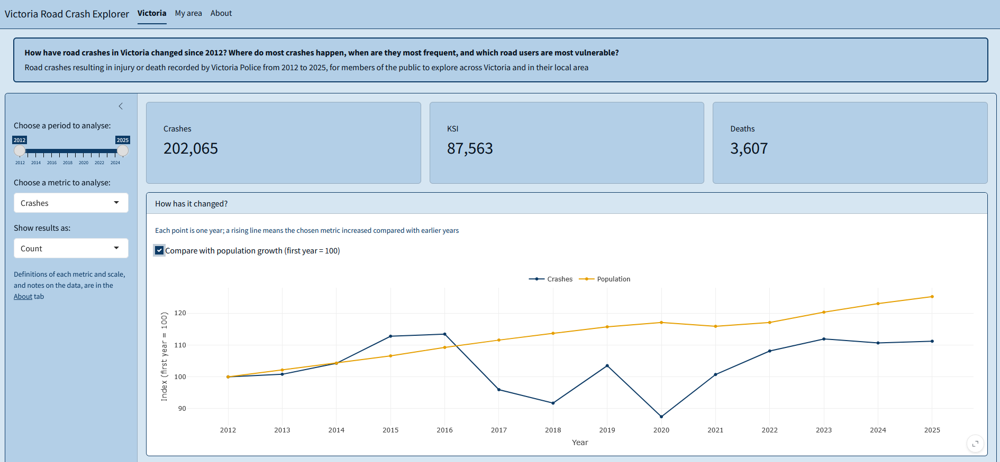
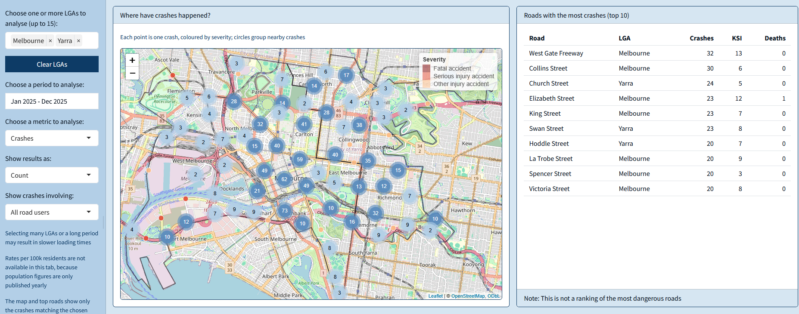

```{r, include = FALSE}
knitr::opts_chunk$set(collapse = TRUE, comment = "#>")
```

## Who this package is for

`roadcrashVIC` is designed for members of the public who want to understand road safety in Victoria, across the state or in their local area. It helps answer one question: **how have road crashes in Victoria changed since 2012, where do most crashes happen, when are they most frequent, and which road users are most vulnerable?**

The package contains cleaned crash, boundary and population data, four functions to filter and summarise the crashes, and a Shiny app to explore the question interactively.

## Installation

The package requires R 4.1.0 or later and is installed from GitHub:

```{r, eval = FALSE}
# install.packages("remotes")
remotes::install_github("ETC5523-2026/etc5523-assignment-4-eduvit")
```

```{r}
library(roadcrashVIC)
```

## The data

`vic_crashes` has one row for each road crash in Victoria in which at least one person was injured or killed, from 2012 to 2025, as recorded by Victoria Police:

```{r}
vic_crashes[1:5, c("accident_date", "lga_name", "severity")]
```

Two further datasets support rates and maps: `vic_population`, the resident population of each local government area (LGA) by year, and `vic_lga`, the LGA boundaries. All three come from Victorian Government and Australian Bureau of Statistics sources under the CC BY 4.0 licence. Their help pages (`?vic_crashes`, `?vic_population`, `?vic_lga`) describe every column and the changes made to the original files.

## The functions

### Filtering by date: `filter_crashes()`

`filter_crashes()` keeps the crashes between two dates, both included:

```{r}
crashes_2025 <- filter_crashes(vic_crashes, start_date = "2025-01-01", end_date = "2025-12-31")
nrow(crashes_2025)
```

### Summarising by any variable: `summarise_crashes()`

`summarise_crashes()` counts crashes and people killed and injured in each group, and the same casualties per 1,000 crashes. KSI stands for people killed or seriously injured.

```{r}
summarise_crashes(crashes_2025, by = "day_of_week")[, c("day_of_week", "crashes", "ksi", "ksi_per_1000_crashes")]
```

The group can be any column of `vic_crashes`, or several columns together, for example `by = c("day_of_week", "hour")`.

### Rates per resident: `crash_rates()`

Areas with more residents usually have more crashes. `crash_rates()` adds the population and the yearly rates per 100,000 residents, which make years or LGAs of different sizes comparable:

```{r}
crash_rates(vic_crashes, vic_population, by = "year")[, c("year", "crashes", "population", "crashes_per_100k")]
```

With `by = "lga_name"`, the rate of each LGA is averaged over the years of the data.

### Vulnerable road users: `summarise_vulnerable()`

`summarise_vulnerable()` applies `summarise_crashes()` to all crashes and to the crashes involving a pedestrian, a cyclist or a motorcyclist:

```{r}
summarise_vulnerable(vic_crashes)[, c("road_user", "crashes", "ksi_per_1000_crashes")]
```

Note: a crash involving more than one of these road users appears in more than one row.

## Launching the app

The app uses the same functions and data. It opens in the browser or in the RStudio/Positron viewer:

```{r, eval = FALSE}
run_app()
```

## Using the app

### Victoria

- **Choose a period to analyse:** the first and last year included.
- **Choose a metric to analyse:** crashes, people killed or seriously injured (KSI), or deaths.
- **Show results as:** a count, a yearly rate per 100k residents, or a rate per 1,000 crashes.
- **Compare with population growth:** an option of the trend chart, which sets the first year to 100 for both the metric and the population.
- **When do crashes happen most?:** a menu above the chart to show months, days of the week or hours of the day.



### My area

- **Choose one or more LGAs to analyse:** up to 15 LGAs; **Clear LGAs** removes them all.
- **Choose a period to analyse:** a range of months; clicking the same month twice selects that month only.
- **Choose a metric to analyse** and **Show results as:** as in the Victoria tab, without rates per resident, as population figures are only published yearly.
- **Show crashes involving:** all crashes, or only those involving pedestrians, cyclists or motorcyclists.



## Selections that are not allowed

Some combinations of inputs cannot give a meaningful result. The app shows a message in place of the affected outputs:

- **Crashes per 1,000 crashes:** always equal to 1,000; the app asks to choose KSI or deaths.
- **No LGA selected** in the My area tab: the app asks to choose at least one.
- **A selection with no crashes**, such as a small area over a short period: the outputs state that no crashes match the selection.
- **A road user filter with the Who chart** in the My area tab: the chart compares road users itself, and asks to select all road users.

## Interpreting the outputs

- **Value boxes:** totals for the selected period, or average rates; the title of each box shows the scale.
- **How has it changed?:** each point is one year. With *Compare with population growth*, both lines start at 100: values above 100 are higher than in the first year, and comparing the two lines shows whether the metric changed faster or slower than the population.
- **When do crashes happen most?:** taller bars mark the times with higher values. With *Per 1,000 crashes*, the bars measure how severe crashes are instead of how frequent.
- **Who is the most vulnerable road user?:** the value for all crashes is shown above the chart; comparing each bar with it shows whether crashes involving that road user are above or below the average.
- **Maps:** on the Victoria map, darker areas have higher values; on the My area map, each point is one crash, coloured by severity. Hovering on a point shows a brief summary of the crash, while clicking shows its details.
- **Roads with the most crashes:** a list of the roads with the most crashes in the selected area; it is not a ranking of the most dangerous roads.

## Limitations

- Rates per resident do not account for how much people drive or for traffic passing through an area; a lower rate does not necessarily mean safer roads.
- Traffic volumes are not included in the data, and roads cannot be compared fairly by their number of crashes.
- Small areas and short periods have few crashes, and their figures can vary considerably by chance.
- Crash numbers in 2020 and 2021 were affected by COVID-19 restrictions.
- Some crashes from late 2025 do not have a recorded location yet; they count only in state-wide totals.

The **About** tab of the app lists all definitions and data sources.
